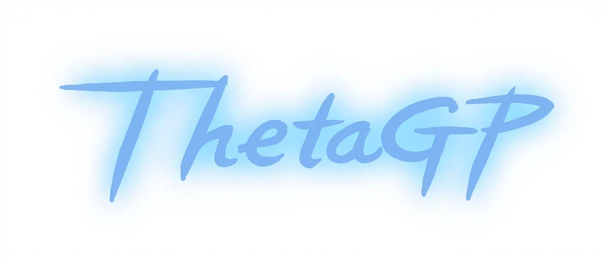

# ThetaGP

<p align="center">
  
</p>

Universal gamepad firmware: a USB device the host binds as a gamepad, plus a
CDC command channel, configured per board. No RTOS, no dynamic allocation.

## Features

- USB device emulators: HID, XInput, PS4 (with its auth channel) and Xbox One
  GIP; GP2040-CE compatible button mapping over a scan-matrix keypad
- CDC command channel carrying protobuf frames (schema: `ThetaGP.PB`): the
  configuration and its keys, the profiles and their bodies, the diagnostics,
  the flash and the firmware's own log
- Configuration keys, profiles and a factory profile on external SPI flash
- An RGB strip driven by the profile: off, the colour wheel, or one colour held
- TOML board configuration, validated and generated at configure time
- Statically allocated, cooperative task scheduler, no RTOS

## Quick Start

```bash
git submodule update --init      # the protocol schema
git submodule update --remote    # to the newest schema on its main
cmake --preset BoringTechH743   # configures, and fetches dependencies
cmake --build --preset BoringTechH743
probe-rs run --chip <CHIP> build/BoringTechH743/ThetaGP_*.elf
```

`CMakePresets.json` declares one preset per board — `BoringTechH743` and
`ThetaGPH7` — each with a `-release` variant, and puts each build tree under
`build/<preset>/`. Configuring by hand with `-DTARGET=<board>` is equivalent.

Needs CMake 4.0+, `arm-none-eabi-gcc`, Python 3.11+ and probe-rs.

## Layout

```
configs/    per-board TOML and its generated BoardConfig.h / board_config.cmake
platform/   MCU ports (STM32H7)
scripts/    build tooling and the host test suites
src/        firmware: wire/ (protocol), drivers/, gamepad/, utils/
lib/        third-party, fetched at configure time; the protocol schema is the
            submodule lib/ThetaGP.PB, following its main
```

Board configuration is TOML under `configs/<TARGET>/BoardConfig.toml`; see
`configs/CONFIGURATION.md` for the fields. The configure step also writes
`.clangd` with the toolchain's include search list, which the compilation
database does not carry.

## Host toolkit

The host side of the same protocol is [ThetaGPToolkit][toolkit]: one Rust
workspace carrying the wire, the device as a model, the tools, a daemon, an MCP
server and a terminal window. It is a repository of its own and neither side
builds the other — the firmware builds with no toolkit present, and the toolkit
reads no firmware checkout or build directory. What holds them together is the
schema: both carry `ThetaGP.PB` on its `main`, the one commit the branch is on.

```bash
git clone https://github.com/sin1111yi/ThetaGPToolkit
cd ThetaGPToolkit && git submodule update --init
cargo run -p thetagp-tui                 # a board, or `simulated`
cargo run -p thetagp-tui -- --frame      # one screen, as text
cargo run -p thetagp-mcp -- --simulated  # the tools, for a model host
```

A device is one port, so one process opens it: the **daemon**, which the window
and the MCP server both ask over a local socket. A client that finds no daemon
starts one beside itself, so the daemon is only something to run by hand when
its log is wanted.

The window shows the board's identity, the configuration as a menu grouped by
the path each key's name carries, the button remap table one input at a time,
the profiles, and a snapshot; a column beside it says what the line in focus
means, and the log below that column is the **firmware's own log**, read over
the protocol rather than a serial port.

[toolkit]: https://github.com/sin1111yi/ThetaGPToolkit

## Dependencies

Declared in `lib/CMakeLists.txt` and fetched at configure. Every dependency
follows its branch and is checked once a day — the protocol schema included: it
is the submodule at `lib/ThetaGP.PB`, on the schema repository's `main`, and it
is the contract the host toolkit speaks as well, so both sides carry one commit.

| Library | Purpose |
|---|---|
| TinyUSB | USB device stack |
| frozen | JSON parser behind `src/utils/json` (profile bodies) |
| nanopb | protobuf codec for the wire |
| mbedTLS | fetched, not linked |
| ThetaGP.PB | the protocol schema, shared with the host toolkit |

## License

GPL-3.0
